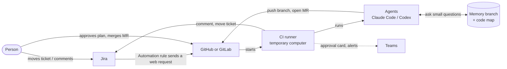
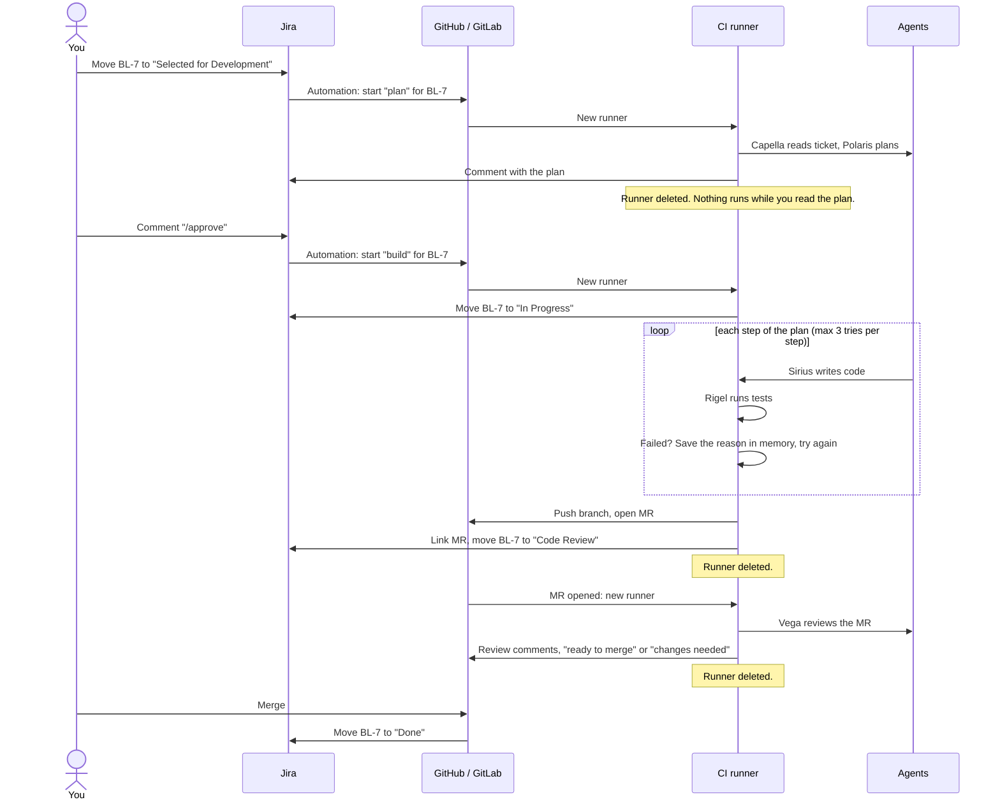
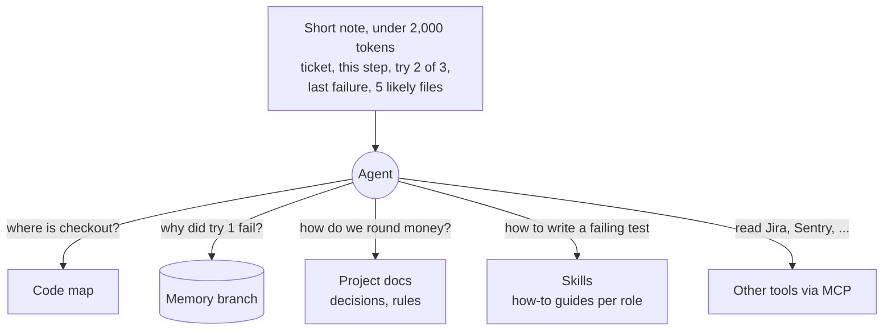

# How basivo-factory works

basivo-factory lets AI agents do the work of a development team: they read a Jira ticket, plan it, write the code, test it, fix it, open a merge request, and review it. People only approve the plan and merge the result.

Nothing runs all the time. Each piece of work starts when someone does something in Jira, runs on a CI runner for a few minutes, and stops.

## 1. The pieces

| Piece | What it is | Its job here |
|---|---|---|
| **Jira** | Where the team keeps tickets | The to-do list. Moving a ticket starts the agents. Agents post their progress here. |
| **Jira Automation** | Rules built into Jira ("when X happens, do Y") | Tells GitHub or GitLab to start a run when a ticket moves or gets a comment |
| **GitHub / GitLab** | Where the code lives | Holds the code, the merge requests and the CI runners |
| **CI runner** | A temporary computer GitHub or GitLab lends us for one job | Runs the agents. Created at the start of a run, deleted at the end. |
| **Agents** | Claude Code or Codex, each with one role | Plan, write code, review. Each one sees only what its role needs. |
| **Memory branch** | A git branch named `factory-memory` in the same repo | What the agents remember: plans, past attempts, why tests failed, lessons learned |
| **Code map** | A search index of the code | Lets an agent ask "where is X?" instead of reading every file |
| **Microsoft Teams** | Chat | Plan approval button and "needs help" alerts (later) |

## 2. The big picture



## 3. The team: one agent per role

| Agent | Role | Can edit code? |
|---|---|---|
| **Capella** | Reads the ticket and prepares it | No |
| **Polaris** | Planner: splits the ticket into small steps, each with a test that proves it is done | No |
| **Sirius** | Developer: writes the code for one step | Yes |
| **Rigel** | Tester: runs the tests. Plain code, not AI, so it cannot lie about results | No |
| **Vega** | Reviewer: reads the merge request and comments | No |
| **Arcturus** | Opens the merge request and updates Jira | No |

## 4. One ticket from start to finish



## 5. When work starts and stops

Every run has a clear start (something a person does) and a clear end (the agents need a person again). Between runs nothing runs and nothing costs money. Where a ticket stands is saved in Jira and in the memory branch, so the next run continues from there.

| Run | Starts when | Does | Ends when |
|---|---|---|---|
| **Plan** | Ticket moved to **Selected for Development** | Read ticket, make plan | Plan posted on the ticket |
| **Build** | `/approve` comment on the ticket | Code, test, fix (max 3 tries per step), open MR | MR opened, or 3 failures: ticket gets a red flag and a comment asking for help |
| **Review** | MR opened or updated (also MRs people open) | Review the change | Comments posted. "Changes needed" starts Build again (max 3 rounds). |
| **Ship** | MR merged | Deploy, save lessons to memory | Ticket moved to **Done** |

Safety rules:
- Only one run per ticket at a time; a second trigger waits.
- `/stop` on the ticket cancels the current run.
- Every run has a time limit and a cost limit.
- Only people allowed by Jira permissions can move tickets or approve.

## 6. The Jira board

```
To Do │ Selected for Development │ In Progress │ Code Review │ Testing │ Done
```

| Column | Who moves the ticket here | What happens |
|---|---|---|
| To Do | People | Nothing |
| Selected for Development | People | Plan run starts |
| In Progress | Agents, after `/approve` | Code is being written and tested |
| Code Review | Agents | MR is open, Vega reviews it |
| Testing | People (optional) | You try it yourself |
| Done | Merge | Finished |

A ticket the agents could not finish gets Jira's red **Flag** and a comment explaining the 3 failed tries.

## 7. How agents know the project without reading all of it

Reading the whole repository for every small fix wastes tokens, and models answer worse when given too much text. So an agent starts with a very short note and asks for anything else it needs.



- **Short note**: the only thing given to the agent at the start.
- **Code map**: answers "where is X" and "what calls Y" without opening files.
- **Memory branch**: every attempt, why it failed, what was learned. Each entry remembers which version of each file it was about; if the file changed since, the entry is marked "check again" instead of being trusted.
- **Project docs**: the team's decisions (for example "round money once, at the end").
- **Skills**: short how-to guides; each role gets its own.
- **MCP**: the standard way to plug in tools such as Jira or Sentry.

## 8. How we stop made-up answers

The agents' word is never the final answer. Plain code checks it.

| The agent says | The pipeline checks |
|---|---|
| "Done, it works" | Runs the tests itself. Tests decide, not the agent. |
| "I changed `cart.js`" | Compares with the real git diff |
| "This line has a bug" (review) | The finding must name the file and quote the code, or it is dropped |
| Uses an old memory | The file changed since? The memory is marked "check again". |

First real run (GitHub, issue #1 of factory-demo): 5 agent runs, about $0.15, 2.5 minutes of agent time, 0 false claims, all tests passing.

## 9. Setup: the tokens

Two passwords connect the pieces. The owner creates them and pastes them only where shown; they are never written into code.

| Token | Created in | Stored in | Lets |
|---|---|---|---|
| GitHub fine-grained token (only this repo, "Actions: read and write") | GitHub settings | Jira Automation rule | Jira start a run. It cannot change code. |
| Atlassian API token | Atlassian account settings | GitHub secret `JIRA_API_TOKEN` | The runner comment on and move tickets |
| Claude token | `claude setup-token` | GitHub secret `CLAUDE_CODE_OAUTH_TOKEN` | Agents use Claude |

Two plain settings (not secret) go in the repo's Actions variables: `JIRA_BASE_URL` (for example `https://acme.atlassian.net`) and `JIRA_EMAIL` (the account that made the Atlassian token).

The Jira Automation rule for "Selected for Development":

```
When:  Work item transitioned to "Selected for Development"
Then:  Send web request
       URL:     https://api.github.com/repos/<owner>/<repo>/actions/workflows/factory.yml/dispatches
       Method:  POST
       Headers: Authorization: Bearer <GitHub token>
                Accept: application/vnd.github+json
       Body:    {"ref": "main", "inputs": {"ticket": "{{issue.key}}", "run": "plan"}}
```

The `/approve` rule is the same with "When: comment added" plus the condition "comment contains /approve", and `"run": "build"` in the body.

The workflow can also be started by hand: repo → Actions → factory → Run workflow → enter `BL-7`.

## 10. GitHub now, office GitLab later

The core does not care which tracker or code host is used; each one is a small plug-in.

| | Demo (now) | Office (later) |
|---|---|---|
| Tickets | Jira (`BL` project) | Jira or YouTrack |
| Code + MRs | GitHub | GitLab |
| Runner | GitHub free runner | Office GitLab runners |
| Start a run | Jira rule → GitHub workflow `dispatches` API | Jira rule → GitLab `trigger/pipeline` API |
| AI login | Personal Claude subscription | Company API keys |

## 11. Words used here

| Word | Meaning |
|---|---|
| Runner | A temporary computer that runs one job, then is deleted |
| MR / PR | Merge request (GitLab) / pull request (GitHub): a proposed code change waiting for review |
| MCP | Model Context Protocol: the standard plug for giving an agent a tool |
| Skill | A short how-to guide (`SKILL.md`) an agent can open when needed |
| Token (password) | A secret key that lets one system act on another |
| Token (AI) | A piece of text the model reads or writes; cost is counted in these |
